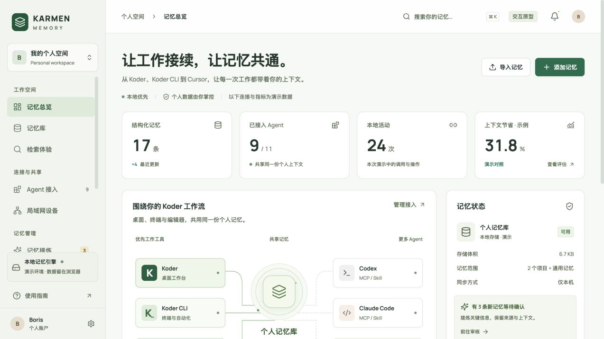

# KARMEN Memory

English | [简体中文](README.zh-CN.md)

An interactive prototype for inspecting personal memories: where a fact came from, which scope it belongs to, and what context an agent might receive. Data stays in the browser; real agent connections and device synchronization are not integrated.

[Download prototype v0.1.1](https://github.com/KarmenLoop/karmen-memory/releases/tag/v0.1.1) · [User guide](docs/tutorial.en.md) · [Issues](https://github.com/KarmenLoop/karmen-memory/issues)

## What you can try

Create, edit, search, favorite, archive, and restore memories. Import or export JSON, review candidates and scope conflicts, and inspect local keyword retrieval. Tool access settings and device pairing are labeled simulations.



*Actual browser capture of v0.1.1 using synthetic data. Documentation is bilingual; the application interface is currently Chinese.*

## Start here

For the quickest route, download the preview ZIP and run this inside the extracted karmen-memory-preview directory:

```sh
python3 -m http.server 5187 --bind 127.0.0.1
```

Open http://127.0.0.1:5187. For source work choose the source ZIP and use Node 22.12+ and npm:

```sh
npm ci
npm run build
npm run preview -- --port 5187 --strictPort
```

## A first useful task

Add a fictional preference in the memory library, search its title, reload to confirm it remains, then archive, restore, and export it. Retrieval uses local keywords, not a model or embedding service. The Koder, Koder CLI, Cursor order does not indicate connected real tools.

## Data and limits

Data lives in localStorage for the current browser origin under karmen-memory-console-demo-v1; it is not encrypted storage. Another port, browser, or device has separate data. Use synthetic records and no credentials. Pairing code 246810 and the 31.8% figure are demonstrations; the latter is not a cost benchmark.

## Documentation and license

[Download, setup, practice, and updates](docs/tutorial.en.md) · [Design](https://github.com/KarmenLoop/karmen-memory/blob/v0.1.1/docs/design.md) · [Validation](https://github.com/KarmenLoop/karmen-memory/blob/v0.1.1/docs/validation.md) · [Apache-2.0](LICENSE) · [NOTICE](NOTICE) · [Third-party notices](THIRD_PARTY_NOTICES.md)

The included shared-memory-console skill guides memory administration design; loading it does not start a memory service.
