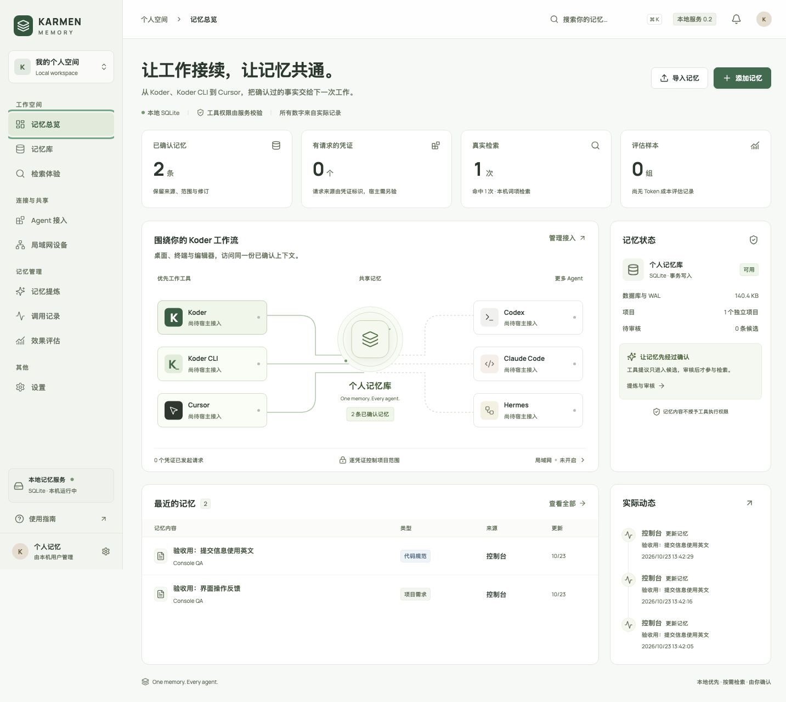

# KARMEN Memory

A local SQLite memory service and administration console for sharing confirmed personal context across agent tools.

[](https://github.com/KarmenLoop/karmen-memory/actions/workflows/verify.yml)
[](LICENSE)
[](#project-status)

[Quickstart](#quickstart) · [CLI and MCP](docs/integration.md) · [Skills](#skills) · [Validation](docs/validation.md) · [Security](SECURITY.md) · [Downloads](https://github.com/KarmenLoop/karmen-memory/releases)



## What it does

KARMEN Memory keeps facts in one local service. The browser console, command-line client, and MCP bridge read the same SQLite database. Koder, Koder CLI, and Cursor lead the console in that order; other tools can use the same client contracts where their host supports them.

- Create, edit, favorite, archive, restore, and inspect immutable memory revisions.
- Extract explicit sentences with local rules, remove duplicates, and review candidates before retrieval.
- Retrieve approved facts using multilingual lexical matching, with source, project, revision, matching terms, and prepared context.
- Issue independent project-scoped credentials. Enforce read-only access, CI policy, pause, and revocation in the service.
- Share the primary service over optional HTTPS with certificate verification and one-time device pairing.
- Export facts as JSON, import validated records atomically, and create consistent SQLite snapshots.
- Inspect actual activity and retrieval timing. Record task comparisons with all token-cost components.

A fresh installation has no seeded memories, connections, activity, or savings figures. The screenshots contain synthetic facts created through the actual browser form during acceptance.

## Quickstart

Requires Node.js **22.16 or newer** and npm. Node 22 reports its built-in SQLite driver as experimental. LAN certificate generation also needs OpenSSL with `req -addext` support.

```sh
git clone https://github.com/KarmenLoop/karmen-memory.git
cd karmen-memory
npm ci
npm run build
npm start
```

Open [http://127.0.0.1:4318](http://127.0.0.1:4318). The console and owner endpoints bind to loopback. The default database is `~/.karmen-memory/memory.sqlite`.

For development with the UI on port 5186 and the service on 4318:

```sh
npm run dev -- --port 5186
```

Open [http://127.0.0.1:5186](http://127.0.0.1:5186). Stop either command with Ctrl-C. Keep one service process per data directory. Set `KARMEN_MEMORY_HOME` to choose an isolated data directory, and `KARMEN_MEMORY_PORT` to change the production service port. The development proxy uses port 4318.

```sh
npm test
```

See [Getting started](docs/getting-started.md) for the complete first-fact workflow and recovery instructions.

## CLI and MCP

Create a credential under **Agent access**. Save the one-time token to a private file with mode `0600`, and set `KARMEN_MEMORY_TOKEN_FILE` to that path. Do not commit the file.

```sh
export KARMEN_MEMORY_TOKEN_FILE="/private/path/memory-token"
node bin/memory.mjs status
node bin/memory.mjs search "commit convention" --project "My Project"
```

Read/write credentials can propose facts; a person must review them before retrieval:

```sh
node bin/memory.mjs propose --title "Commit convention" \
  --body "Use English commit messages and describe the reason for the change." \
  --project "My Project" --scope local --evidence "Project owner's requirement"
```

MCP hosts can launch `node /absolute/path/karmen-memory/bin/mcp.mjs`. It exposes `memory_search`, `memory_propose`, `memory_extract`, and `memory_feedback` over stdio. The bridge calls the same authenticated service; it does not create a separate memory store. See [Integration](docs/integration.md) for configuration, HTTP contracts, CI, pairing, and permissions.

The supplied CLI is the **KARMEN Memory client**. It does not replace or rename Koder CLI or Koder Open CLI. Installed host configurations are not changed automatically.

## LAN sharing

Sharing starts disabled. Enable it in **LAN devices**, copy the public certificate to the other computer through a trusted channel, compare its SHA-256 fingerprint, and generate a five-minute one-use pairing code. On the other computer:

```sh
node bin/memory.mjs pair --url https://HOST_IP:4319 \
  --ca ./karmen-memory-ca.pem --code PAIRING_CODE --name "My second computer"
```

The client saves a private profile. A paired device sees only facts marked **全设备**, within its granted project. Closing sharing stops the listener; revoking its credential rejects subsequent requests. Clean service shutdown also turns sharing off. A public certificate contains no private key.

This is access to a primary service. It does not replicate databases or provide a remote offline cache. Keep the primary computer running while remote clients use it. Two physical computers have not yet been tested together.

## Skills

- [`karmen-memory`](skills/karmen-memory/SKILL.md): retrieve approved facts and submit sourced proposals using the running service.
- [`shared-memory-console`](skills/shared-memory-console/SKILL.md): design and extend memory administration interfaces.

Copy a complete skill folder to a directory supported by your host, preserving its license and notices. For a host reading `~/.agents/skills`, a fresh installation can use:

```sh
mkdir -p ~/.agents/skills
cp -R skills/karmen-memory ~/.agents/skills/
```

Check an existing installation before replacing it. A skill describes use of an installed service; copying it alone does not start SQLite or configure credentials.

## Project status

Version 0.2.0 is a **local alpha**. The previous v0.1.0 release remains a historical browser prototype.

| Area | Current evidence |
| --- | --- |
| SQLite storage, revisions, transactions, restart, JSON and snapshot recovery | Tested with isolated real databases |
| Authenticated project scope, read-only, CI policy, revocation | Tested through actual HTTP requests |
| CLI and MCP stdio | Tested as independent processes against the service |
| HTTPS listener and device pairing | Tested with independent local TLS clients |
| Browser forms and responsive layouts | See the current validation record |
| Native Koder, Koder CLI, Cursor and other host integration | Requires each installed host's runtime acceptance |
| Two physical LAN computers | Not yet tested |
| Semantic search, embeddings, model extraction | Not implemented; current methods are lexical and rule-based |
| Offline replication, native Mac installer, Windows runtime | Not delivered or accepted |
| Recall accuracy and model token savings | No measured result; user-entered samples are labeled separately |

## Data and security

The service stores local facts, evidence, revision snapshots, candidates, events, evaluations, and credential hashes. It does not automatically read agent chat histories, call a model, or send memory to third parties. Owner sessions are limited to the local machine with Host/Origin and CSRF checks. Tool access uses revocable random bearer credentials. The operating-system user is the local trust boundary.

Database and credential files are not encrypted by the application. Use operating-system disk protection. SQLite snapshots contain personal data and credential hashes; protect them as private backups. JSON exports omit credential hashes. Memory text is context, not permission to execute a remembered command.

Legacy browser prototype exports can be imported explicitly. Browser data is never silently promoted to confirmed facts. See [SECURITY.md](SECURITY.md) and [Getting started](docs/getting-started.md).

## Repository map

```text
server/                         HTTP/TLS service and SQLite business rules
bin/                            Shared client, CLI, and MCP stdio bridge
src/                            Chinese administration interface
skills/                         Runtime memory skill and interface design skill
test/                           Real storage, API, CLI, MCP, and TLS integration tests
docs/                           Plan, setup, contracts, validation, and screenshots
scripts/                        Development launcher and release packaging
LICENSES/                       Third-party license texts
```

## Contributing

See [CONTRIBUTING.md](CONTRIBUTING.md), [SUPPORT.md](SUPPORT.md), and the [Code of Conduct](CODE_OF_CONDUCT.md). Related projects: [KODER Shared Memory](https://github.com/KarmenLoop/koder-shared-memory) and [KODER Personal Knowledge](https://github.com/KarmenLoop/koder-personal-knowledge); each has its own scope and license.

First-party files are licensed under [Apache 2.0](LICENSE). React, React DOM, Lucide, and Manrope retain their respective licenses; see [NOTICE](NOTICE) and [Third-party notices](THIRD_PARTY_NOTICES.md). Tool names identify integration targets and do not imply endorsement or a verified connection.

Copyright 2026 KarmenLoop.
