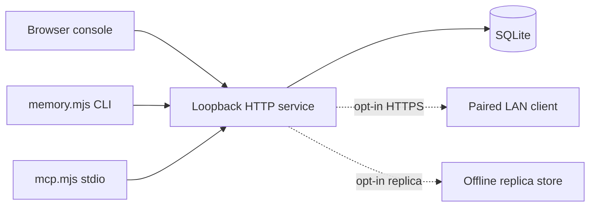

# KARMEN Memory

[English](README.md) · [中文](README.zh-CN.md) · **v0.3.0**

[](https://github.com/KarmenLoop/karmen-memory/actions/workflows/verify.yml)
[](https://github.com/KarmenLoop/karmen-memory/releases/latest)
[](https://nodejs.org/)
[](LICENSE)
[](#project-status)

**One local SQLite memory service—shared by a browser console, CLI, and MCP bridge—so confirmed personal and project facts stay consistent across agent tools.**

KARMEN Memory is a **local-first** memory stack: transactional revisions, candidate review before retrieval, project-scoped credentials, optional trusted-LAN HTTPS pairing, and opt-in offline replicas. It does **not** call a model, scrape chat history, or ship embeddings. Fresh installs start empty.

Built and maintained by [KarmenLoop](https://github.com/KarmenLoop) / [KARMENLOOP](https://karmenloop.com). Current release: **[v0.3.0](https://github.com/KarmenLoop/karmen-memory/releases/tag/v0.3.0)**. License: **Apache License 2.0**.


*Service-backed capture with synthetic facts entered through the real browser form. A new install has no seeded memories, connections, activity, or savings figures.*


[Download v0.3.0](https://github.com/KarmenLoop/karmen-memory/releases/tag/v0.3.0) · [User guide](docs/tutorial.en.md) · [中文教程](docs/tutorial.zh-CN.md) · [Integration](docs/integration.md) · [Offline replicas](docs/replication.en.md) · [Validation](docs/validation.md)

---

## Why this exists

Agent tools forget what you already confirmed: commit conventions, project constraints, durable preferences. When each host invents its own store—or treats chat residue as memory—facts drift, credentials leak into free text, and “saved” knowledge cannot be audited.

KARMEN Memory treats memory as **confirmed context under human review**:

- one SQLite authority on loopback;
- proposals from tools, **approval** before retrieval;
- immutable revision history and project scope;
- credentials you can pause or revoke;
- LAN and replica modes that stay explicit and opt-in.

It does not replace your host’s model, tools, or secret store. It does not claim semantic search or measured token savings.

---

## Snapshot

| | |
|---|---|
| **What you run** | Local HTTP service + Chinese administration UI (`server/`, `src/`) |
| **Clients** | Browser console, `bin/memory.mjs` CLI, `bin/mcp.mjs` stdio bridge |
| **Skills** | `skills/karmen-memory` (runtime), `skills/shared-memory-console` (UI design) |
| **Version** | **0.3.0** (`package.json`, release tag, publication identity) |
| **Runtime** | Node.js **22.16+**, npm; Node 22’s built-in SQLite is still experimental |
| **Default ports** | Production console **4318** (loopback); optional LAN HTTPS **4319**; Vite UI **5186** in `npm run dev` |
| **Default data** | `~/.karmen-memory/memory.sqlite` (override with `KARMEN_MEMORY_HOME`) |
| **Retrieval** | Multilingual **lexical** matching — not embeddings |
| **Extraction** | Local sentence rules → candidates → human review |
| **CI** | GitHub Actions **Build**: `npm test`, `npm run build`, runtime verify, `check_publication.py` |
| **License** | Apache 2.0 (first-party); third-party notices in [NOTICE](NOTICE) / [THIRD_PARTY_NOTICES.md](THIRD_PARTY_NOTICES.md) |

---

## Is / Is not

| Is | Is not |
|---|---|
| Local SQLite memory service with console, CLI, and MCP | Cloud memory SaaS or hosted vector DB |
| Confirmed facts after candidate review | Automatic promotion of chat history into truth |
| Project-scoped, revocable bearer credentials | Unscoped “remember everything” dump |
| Optional HTTPS LAN pairing + offline replicas | Always-on public sync or mesh |
| Lexical search with source, revision, and match terms | Semantic / embedding retrieval |
| Local alpha with honest NOT_RUN boundaries | Measured multi-host recall accuracy or savings claims |

---

## Architecture

Three surfaces, one database:

1. **Service** — `server/` owns HTTP/TLS, SQLite transactions, revisions, candidates, credentials, audit, LAN, and replicas.
2. **Console** — React UI for facts, candidates, agent access, activity, LAN devices, and replica settings.
3. **Clients** — CLI and MCP call the **same** authenticated API; they do not create a second store.



Owner sessions stay on the local machine (Host/Origin + CSRF). Tool access uses random bearer credentials with project scope, read-only / CI policy, pause, and revocation. The OS user is the local trust boundary; the app does not encrypt the database at rest—use OS disk protection.

---

## What you can do

- Create, edit, favorite, archive, restore, and inspect **immutable** revisions.
- Extract explicit sentences with local rules, dedupe, and review candidates before retrieval.
- Search approved facts with multilingual lexical matching; return source, project, revision, matching terms, and prepared context.
- Issue independent project-scoped credentials; enforce read-only, CI policy, pause, and revocation in the service.
- Share the primary over optional HTTPS with certificate verification and one-time device pairing.
- Export JSON, import validated records atomically, and take consistent SQLite snapshots.
- Inspect real activity and retrieval timing; record task comparisons with all token-cost components labeled as user-entered samples.
- Run **opt-in offline replicas** (v0.3.0): project-scoped HTTPS transfer, durable versions, conflict review, deletion markers.

---

## Quickstart

**Requirements:** Node.js **22.16+**, npm. LAN certificates also need OpenSSL with `req -addext`.

```sh
git clone https://github.com/KarmenLoop/karmen-memory.git
cd karmen-memory
npm ci
npm run build
npm start
```

Open [http://127.0.0.1:4318](http://127.0.0.1:4318). Default database: `~/.karmen-memory/memory.sqlite`. One service process per data directory. Set `KARMEN_MEMORY_HOME` / `KARMEN_MEMORY_PORT` as needed.

Development (UI **5186**, service **4318**):

```sh
npm run dev -- --port 5186
```

```sh
npm test
```

First-fact workflow and recovery: [docs/getting-started.md](docs/getting-started.md) · full guide: [docs/tutorial.en.md](docs/tutorial.en.md).

---

## CLI and MCP

Create a credential under **Agent access**. Save the one-time token to a private file mode `0600`, point `KARMEN_MEMORY_TOKEN_FILE` at it. Do not commit tokens.

```sh
export KARMEN_MEMORY_TOKEN_FILE="/private/path/memory-token"
node bin/memory.mjs status
node bin/memory.mjs search "commit convention" --project "My Project"
```

Read/write credentials can **propose** facts; a person must review them before retrieval:

```sh
node bin/memory.mjs propose --title "Commit convention" \
  --body "Use English commit messages and describe the reason for the change." \
  --project "My Project" --scope local --evidence "Project owner's requirement"
```

MCP hosts can launch `node /absolute/path/karmen-memory/bin/mcp.mjs` for `memory_search`, `memory_propose`, `memory_extract`, and `memory_feedback` over stdio. Contracts, CI policy, pairing, and permissions: [docs/integration.md](docs/integration.md).

This CLI is the **KARMEN Memory client**. It does not replace Koder CLI. Installing skills does not rewrite host configs automatically.

---

## LAN and offline replicas

Sharing starts **disabled**. Enable under **LAN devices**, copy the public CA through a trusted channel, compare SHA-256, issue a five-minute one-use pairing code, then on the other machine:

```sh
node bin/memory.mjs pair --url https://HOST_IP:4319 \
  --ca ./karmen-memory-ca.pem --code PAIRING_CODE --name "My second computer"
```

Paired devices see only facts marked for all devices, within granted projects. Closing sharing stops the listener; revoking credentials rejects later requests. Clean shutdown turns sharing off. The public certificate holds no private key.

Offline replicas use the same approved library with project-scoped HTTPS, conflict review, and deletion markers. Two independent stores have been exercised on one Mac; **two physical computers remain untested**. Guides: [docs/replication.en.md](docs/replication.en.md) · [docs/replication.zh-CN.md](docs/replication.zh-CN.md).


---

## Skills

| Skill | Role |
|---|---|
| [`karmen-memory`](skills/karmen-memory/SKILL.md) | Retrieve approved facts; submit sourced proposals via the running service |
| [`shared-memory-console`](skills/shared-memory-console/SKILL.md) | Design and extend memory administration interfaces |

Copy a complete skill folder into a host-supported skills directory, preserving license and notices. Example for a fresh `~/.agents/skills` install:

```sh
mkdir -p ~/.agents/skills
cp -R skills/karmen-memory ~/.agents/skills/
```

A skill describes use of an **installed** service; copying it alone does not start SQLite or issue credentials.

---

## Project status

Version **0.3.0** is a **local alpha**. v0.2.0 introduced the local service; v0.1.0 remains a historical browser prototype.

| Area | Current evidence |
|---|---|
| SQLite storage, revisions, transactions, restart, JSON/snapshot recovery | Tested with isolated real databases |
| Authenticated project scope, read-only, CI policy, revocation | Tested through actual HTTP requests |
| CLI and MCP stdio | Tested as independent processes against the service |
| HTTPS listener and device pairing | Tested with independent local TLS clients |
| Browser forms and responsive layouts | See [docs/validation.md](docs/validation.md) |
| Live tool calls on selected hosts | Partial — some hosts accepted live calls; others blocked by local auth/quota; each host needs its own runtime acceptance |
| Two physical LAN computers | Not yet tested |
| Semantic search, embeddings, model extraction | Not implemented |
| Offline replicas | Implemented; same-Mac HTTPS / conflict / deletion / restart checks passed |
| Native Mac installer, Windows runtime | Not delivered or accepted |
| Recall accuracy and model token savings | No measured result |

---

## Data and security

The service stores facts, evidence, revision snapshots, candidates, events, evaluations, and credential hashes. It does **not** automatically read agent chat histories, call a model, or send memory to third parties.

Database and credential files are **not** encrypted by the application. Protect them with OS disk encryption. SQLite snapshots include personal data, credential hashes, and outgoing replica tokens—treat as private backups. JSON exports omit credential hashes. Memory text is context, not permission to execute a remembered command.

Legacy browser-prototype exports import only through an explicit path. See [SECURITY.md](SECURITY.md).

---

## Documentation map

| Doc | Use it when you need… |
|---|---|
| [Tutorial (EN)](docs/tutorial.en.md) · [中文](docs/tutorial.zh-CN.md) | Install, first fact, update/remove |
| [Getting started](docs/getting-started.md) | First-fact workflow and recovery |
| [Integration](docs/integration.md) | CLI/MCP contracts, credentials, CI, pairing |
| [Replication EN](docs/replication.en.md) · [中文](docs/replication.zh-CN.md) | Offline replica setup |
| [Validation](docs/validation.md) | What was run vs NOT_RUN |
| [Design](docs/design.md) · [Implementation plan](docs/implementation-plan.md) | Console UX and contracts |
| [CHANGELOG](CHANGELOG.md) | Release history through 0.3.0 |
| [SECURITY](SECURITY.md) / [SUPPORT](SUPPORT.md) / [CONTRIBUTING](CONTRIBUTING.md) | Ops |

---

## FAQ

### What is KARMEN Memory, in one sentence?

A local SQLite memory service with a console, CLI, and MCP bridge so confirmed personal and project facts can be shared across agent tools under human review.

### Who should use it?

Operators who already run local coding agents and need durable, auditable context—conventions, constraints, preferences—without a cloud memory product.

### Does installing a skill start the service?

No. Skills do not start processes, create accounts, or issue credentials. Run `npm start` (or your installed service) separately.

### Is search semantic?

No. Retrieval is multilingual **lexical** matching. Embeddings and model extraction are out of scope for 0.3.0.

### Are proposals immediately searchable?

No. Proposals enter candidate review. Only approved facts are retrieved.

### Can I sync two physical machines?

LAN pairing and offline replicas exist, but **two-computer** acceptance is still NOT_RUN. Same-Mac dual-store checks passed for replicas.

### Soft discoverability

Phrases that match this repo: **local agent memory SQLite**, **MCP memory bridge**, **project-scoped memory credentials**, **offline memory replica LAN**, **candidate review before retrieval**. Substance lives in the service and docs—not keyword density.

---

## License and contact

[Apache License 2.0](LICENSE) · [NOTICE](NOTICE) · [THIRD_PARTY_NOTICES.md](THIRD_PARTY_NOTICES.md) · [Code of Conduct](CODE_OF_CONDUCT.md)

Maintainer: [KarmenLoop](https://github.com/KarmenLoop) · Site: [karmenloop.com](https://karmenloop.com)

Issues: [GitHub Issues](https://github.com/KarmenLoop/karmen-memory/issues) · Support: [SUPPORT.md](SUPPORT.md). Prefer synthetic data when filing bugs.

Related (separate scope and license): [koder-shared-memory](https://github.com/KarmenLoop/koder-shared-memory), [koder-personal-knowledge](https://github.com/KarmenLoop/koder-personal-knowledge).

Copyright 2026 KarmenLoop.
