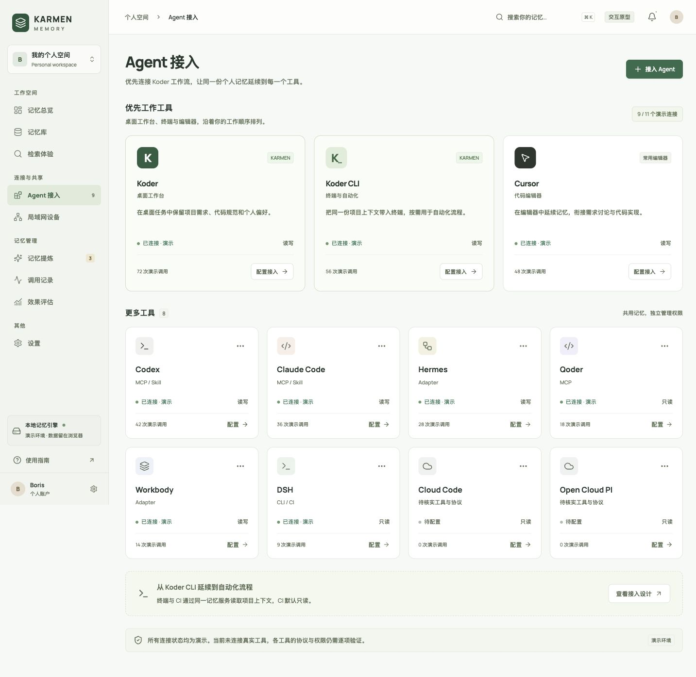

# KARMEN Memory

An interactive console prototype for reviewing personal memory across Koder, Koder CLI, Cursor, and other agent tools.

[](https://github.com/KarmenLoop/karmen-memory/actions/workflows/verify.yml)
[](LICENSE)
[](#project-status)
[](https://github.com/KarmenLoop/karmen-memory/releases)

[Downloads](https://github.com/KarmenLoop/karmen-memory/releases) · [Quickstart](#quickstart) · [Skill](#use-the-skill) · [Design](docs/design.md) · [Validation](docs/validation.md) · [Contributing](CONTRIBUTING.md) · [Support](SUPPORT.md) · [License](LICENSE)


*An actual browser capture of the included Chinese-language interface. Memories, tool connections, device pairing, and evaluation figures are clearly labeled examples.*

## Overview

KARMEN Memory explores how one personal memory library can support work across a desktop assistant, a terminal, and an editor. Koder, Koder CLI, and Cursor lead the interface in that order. Other tools appear in a separate group and keep their own access settings.

The console makes memories inspectable: what a fact says, which project it belongs to, where it came from, and whether it should remain active. It also includes a portable design skill for extending these interfaces and preparing a real memory-service integration.

This repository supplies a working browser prototype and design contract. It does not install a memory framework, connect to real agents, or synchronize databases between computers.

## What works

- Create, edit, search, filter, favorite, archive, and restore memories.
- Import and export JSON, preserving validated lifecycle, provenance, and version fields.
- Review candidate facts and keep conflicting statements with an explicit scope.
- Try local keyword retrieval and inspect the context prepared for an agent.
- Configure simulated tool access and device pairing, with visible error states.
- Inspect activity and evaluation examples.
- Keep prototype changes in the current browser across reloads.

The interface has nine pages: overview, memory library, retrieval, agent access, LAN devices, candidate review, activity, evaluation, and settings. Fonts and icons are bundled locally; the running preview needs no remote font or image requests.

## Quickstart

Use Node.js 22.12 or newer and npm.

```sh
git clone https://github.com/KarmenLoop/karmen-memory.git
cd karmen-memory
npm ci
npm run dev -- --port 5186 --strictPort
```

Open [http://127.0.0.1:5186](http://127.0.0.1:5186). If that port is occupied, choose another port with the same option. The preview binds to loopback.

To build and serve the static application:

```sh
npm run build
npm run preview -- --port 5187 --strictPort
```

Open [http://127.0.0.1:5187](http://127.0.0.1:5187). The static output is in `dist/`.

Release downloads also include a prebuilt preview. After extracting it, serve its directory with a local static server. The included `PREVIEW.md` explains the commands.

See [Getting started](docs/getting-started.md) for the first memory, candidate review, pairing demo, data export, and reset flow.

## Koder-first workflow



| Priority tool | Intended role | Current implementation |
| --- | --- | --- |
| Koder | Desktop work and project context | Simulated access settings |
| Koder CLI | Terminal work and automation | Simulated access settings |
| Cursor | Editor context and implementation | Simulated access settings |

Codex, Claude Code, Hermes, Qoder, Workbody, DSH, Cloud Code, and Open Cloud PI appear under more tools. These are proposed integration targets. Exact product names, versions, and supported protocols must be checked before building adapters.

The priority order is consistent across the overview, access page, and tool picker. Pausing a priority tool keeps its place. Catalog upgrades add missing entries while preserving existing memories and access settings.

## Use the skill

The portable skill is in [`skills/shared-memory-console`](skills/shared-memory-console/SKILL.md). It guides an agent in designing or extending memory administration pages: provenance, candidate review, retrieval explanations, access controls, and trusted devices.

Copy the complete folder into a skill directory supported by your agent host. For a fresh user-level installation in a host that reads `~/.agents/skills`:

```sh
mkdir -p ~/.agents/skills
cp -R skills/shared-memory-console ~/.agents/skills/
```

Keep the references and legal notices with the skill. Check an existing installation before replacing it. A host that supports named skill invocation can use:

```text
Use $shared-memory-console to extend KARMEN Memory's candidate review page.
Preserve the current memory-service contract and show the source and scope
of each fact. Keep sample data clearly labeled until the service is connected.
```

Loading this skill does not start a database, create a network service, or grant access to another tool.

## Project status

The initial release is a **prerelease prototype**. It includes source, a static build, screenshots, design documentation, and the portable skill.

| Area | Status |
| --- | --- |
| Browser interactions and localStorage persistence | Implemented and checked locally |
| Desktop and 390px layouts | Checked in browser emulation |
| Keyword retrieval | Implemented as a local demonstration |
| Real database and extraction framework | Not integrated |
| Semantic search and embeddings | Not integrated |
| Real Koder, Koder CLI, Cursor, or other adapters | Not integrated |
| Authenticated LAN sharing and device synchronization | Not implemented |
| CI access policy enforcement by a memory service | Not implemented |
| Measured recall accuracy or cost savings | Not evaluated |

The 31.8% figure is an illustrative comparison of 88,000 and 60,000 tokens, not a benchmark result. A real evaluation must include extraction, indexing, retrieval, and context costs. See [Validation](docs/validation.md).

## Data and privacy

Sample memories and prototype changes are stored under `karmen-memory-console-demo-v1` in the current browser's localStorage. The application does not read real agent histories, credentials, or personal databases. It does not send prototype memory contents to a model or another device.

localStorage is not an encrypted credential store. Use synthetic data in this prototype. API keys and execution grants stay outside shared memory. UI switches record configuration intent; a real service must enforce access and sync policies.

LAN sharing starts disabled. The fixed pairing code `246810` is for the visible demonstration only. It is not an authentication mechanism for a real service.

## Repository map

```text
src/                            React interface, styles, and sample data
skills/shared-memory-console/   Portable design skill and page contract
docs/                           Quickstart, design, integration, and validation
  images/                       Browser screenshots
scripts/                        Release packaging
.github/                        Build workflow and issue forms
LICENSES/                       Third-party license texts
LICENSE                         Apache License 2.0
NOTICE                          Copyright and attribution
```

## Contributing and support

Focused fixes, clear reproductions, and documentation improvements are welcome. Start with [CONTRIBUTING.md](CONTRIBUTING.md), follow the [Code of Conduct](CODE_OF_CONDUCT.md), and use [GitHub Issues](https://github.com/KarmenLoop/karmen-memory/issues) for ordinary questions. Follow [SECURITY.md](SECURITY.md) for sensitive findings.

Related KarmenLoop projects: [KODER Shared Memory](https://github.com/KarmenLoop/koder-shared-memory) and [KODER Personal Knowledge](https://github.com/KarmenLoop/koder-personal-knowledge). Each has its own scope and license; this console does not automatically integrate either project.

## License and attribution

First-party files are available under the [Apache License 2.0](LICENSE). React, React DOM, Lucide, and Manrope retain their respective licenses. See [NOTICE](NOTICE) and [Third-party notices](THIRD_PARTY_NOTICES.md).

Tool names identify intended integrations. Their inclusion does not imply endorsement, affiliation, or a verified connection.

Copyright 2026 KarmenLoop.
