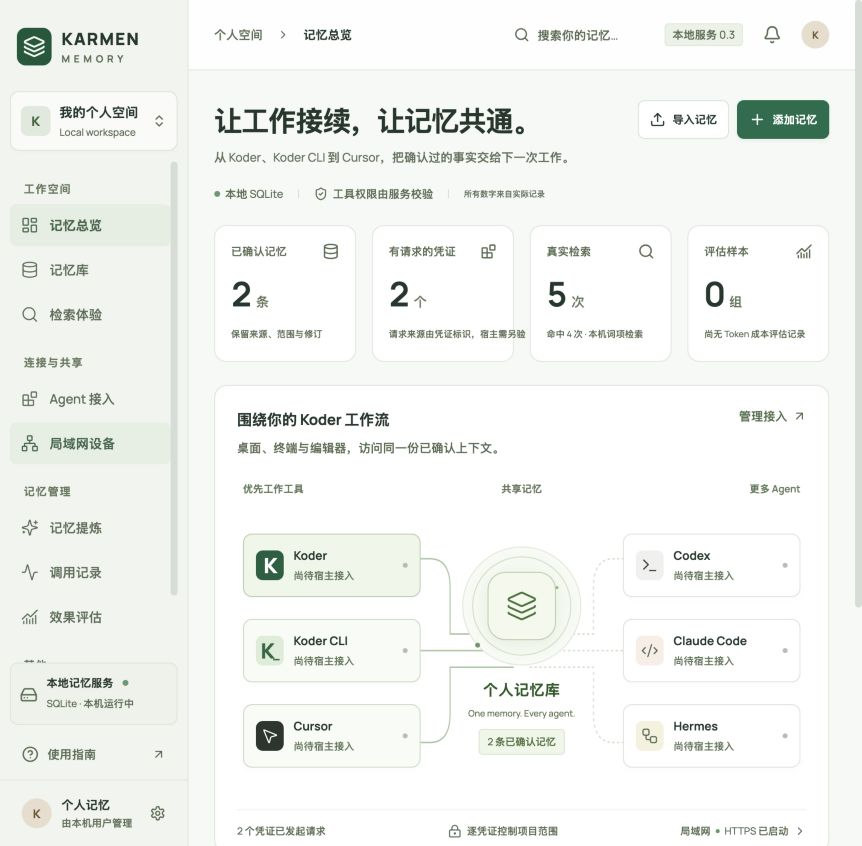
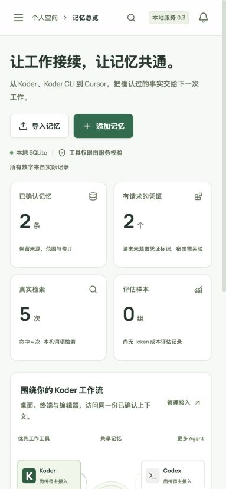
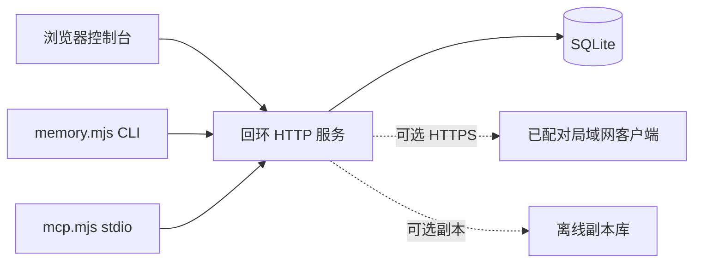
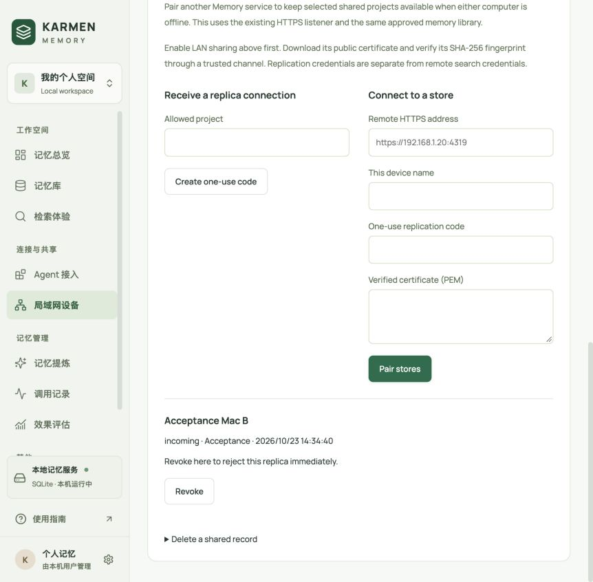
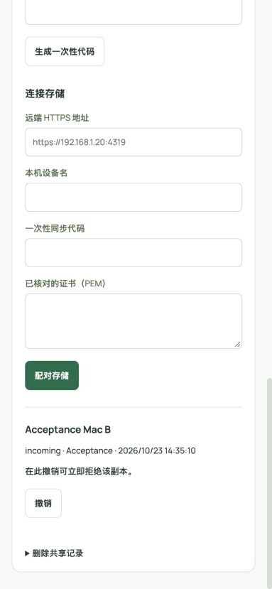

# KARMEN Memory · 卡门记忆

[English](README.md) · [中文](README.zh-CN.md) · **v0.3.0**

[](https://github.com/KarmenLoop/karmen-memory/actions/workflows/verify.yml)
[](https://github.com/KarmenLoop/karmen-memory/releases/latest)
[](https://nodejs.org/)
[](LICENSE)
[](#项目状态)

**一套本机 SQLite 记忆服务——浏览器控制台、CLI 与 MCP 共用同一库——让已确认的个人与项目事实在多个 Agent 工具间保持一致。**

KARMEN Memory 是 **本地优先** 的记忆栈：事务化修订、检索前候选审阅、按项目签发的凭证、可选可信局域网 HTTPS 配对，以及可选离线副本。它**不会**调用模型、不会自动读取聊天记录、也不提供向量检索。全新安装从空库开始。

由 [KarmenLoop](https://github.com/KarmenLoop) / [KARMENLOOP](https://karmenloop.com) 维护。当前版本：**[v0.3.0](https://github.com/KarmenLoop/karmen-memory/releases/tag/v0.3.0)**。许可：**Apache License 2.0**。



*基于真实服务的截图；合成事实由验收人员通过真实表单录入。新安装不会预填记忆、连接、调用记录或节省比例。*



[下载 v0.3.0](https://github.com/KarmenLoop/karmen-memory/releases/tag/v0.3.0) · [中文教程](docs/tutorial.zh-CN.md) · [English guide](docs/tutorial.en.md) · [接入说明](docs/integration.md) · [离线副本](docs/replication.zh-CN.md) · [验收记录](docs/validation.md)

---

## 为什么做这个

Agent 工具常常忘掉你已经确认过的内容：提交规范、项目约束、长期偏好。每个宿主各搞一套存储，或把聊天残留当记忆，事实会漂移，凭证会进明文，「已保存」也无法审计。

KARMEN Memory 把记忆当成 **经人审阅后的确认上下文**：

- 回环地址上的单一 SQLite 权威；
- 工具可提议，**批准后**才可检索；
- 不可变修订历史与项目边界；
- 可暂停、可撤权的凭证；
- 局域网与副本模式保持显式、默认关闭。

它不替代宿主的模型、工具或密钥库，也不声称语义检索或已测得的 token 节省。

---

## 一览

| | |
|---|---|
| **运行内容** | 本机 HTTP 服务 + 中文管理界面（`server/`、`src/`） |
| **客户端** | 浏览器控制台、`bin/memory.mjs` CLI、`bin/mcp.mjs` stdio 桥 |
| **技能** | `skills/karmen-memory`（运行时）、`skills/shared-memory-console`（界面设计） |
| **版本** | **0.3.0**（`package.json`、发布标签、发布身份） |
| **运行时** | Node.js **22.16+**、npm；Node 22 内置 SQLite 仍为实验性 |
| **默认端口** | 生产控制台 **4318**（仅回环）；可选局域网 HTTPS **4319**；`npm run dev` 时 Vite UI **5186** |
| **默认数据** | `~/.karmen-memory/memory.sqlite`（可用 `KARMEN_MEMORY_HOME` 覆盖） |
| **检索** | 多语言 **词项** 匹配——非嵌入向量 |
| **提炼** | 本地句子规则 → 候选 → 人工审阅 |
| **CI** | GitHub Actions **Build**：`npm test`、`npm run build`、运行时校验、`check_publication.py` |
| **许可** | Apache 2.0（第一方）；第三方见 [NOTICE](NOTICE) / [THIRD_PARTY_NOTICES.md](THIRD_PARTY_NOTICES.md) |

---

## 是什么 / 不是什么

| 是 | 不是 |
|---|---|
| 本机 SQLite 记忆服务（控制台 + CLI + MCP） | 云端记忆 SaaS 或托管向量库 |
| 候选审阅后确认的事实 | 自动把聊天历史提升为真相 |
| 按项目、可撤权的 bearer 凭证 | 无边界的「全记住」倾倒 |
| 可选 HTTPS 局域网配对 + 离线副本 | 默认常开的公网同步 |
| 带出处、版本与匹配词的词项检索 | 语义 / 嵌入检索 |
| 边界诚实的本地 Alpha | 已测得多宿主召回率或节省结论 |

---

## 架构

三个表面，一个数据库：

1. **服务** — `server/` 负责 HTTP/TLS、SQLite 事务、修订、候选、凭证、审计、局域网与副本。
2. **控制台** — React 界面：事实、候选、Agent 接入、活动、局域网设备与副本设置。
3. **客户端** — CLI 与 MCP 调用**同一**认证 API，不另建存储。



所有者会话留在本机（Host/Origin + CSRF）。工具访问使用随机 bearer 凭证，支持项目范围、只读 / CI 策略、暂停与撤权。操作系统用户是本地信任边界；应用**未**做静态加密——请使用系统磁盘保护。

---

## 已实现能力

- 创建、编辑、收藏、归档、恢复，并查看 **不可变** 修订。
- 用本地句子规则提炼明确要求，去重后进入候选，人工确认后才能检索。
- 多语言词项检索，返回出处、项目、版本、匹配词与上下文。
- 独立项目凭证；服务端实际检查只读、CI 限制、暂停与撤权。
- 可选 HTTPS 局域网、证书指纹核对、一次性设备配对。
- JSON 导入导出、完整校验与事务、SQLite 一致性快照。
- 真实调用与检索耗时；任务成本对照明确标注为用户录入样本。
- **可选离线副本**（v0.3.0）：按项目 HTTPS 传输、持久版本、冲突审阅、删除标记。

---

## 快速开始

**要求：** Node.js **22.16+**、npm。局域网证书还需支持 `req -addext` 的 OpenSSL。

```sh
git clone https://github.com/KarmenLoop/karmen-memory.git
cd karmen-memory
npm ci
npm run build
npm start
```

打开 [http://127.0.0.1:4318](http://127.0.0.1:4318)。默认库：`~/.karmen-memory/memory.sqlite`。同一数据目录只跑一个服务。可用 `KARMEN_MEMORY_HOME` / `KARMEN_MEMORY_PORT` 调整。

开发模式（UI **5186**，服务 **4318**）：

```sh
npm run dev -- --port 5186
```

```sh
npm test
```

首条事实与恢复：[docs/getting-started.md](docs/getting-started.md) · 完整教程：[docs/tutorial.zh-CN.md](docs/tutorial.zh-CN.md)。

---

## CLI 与 MCP

在 **Agent 接入** 签发凭证。把一次性令牌存到权限 `0600` 的私有文件，用 `KARMEN_MEMORY_TOKEN_FILE` 指向它。不要提交令牌。

```sh
export KARMEN_MEMORY_TOKEN_FILE="/private/path/memory-token"
node bin/memory.mjs status
node bin/memory.mjs search "提交规范" --project "My Project"
```

读写凭证可以 **提议** 事实；须经人审阅后才能检索：

```sh
node bin/memory.mjs propose --title "提交规范" \
  --body "使用英文提交说明，并写明变更原因。" \
  --project "My Project" --scope local --evidence "项目负责人要求"
```

MCP 宿主可启动 `node /absolute/path/karmen-memory/bin/mcp.mjs`，提供 `memory_search`、`memory_propose`、`memory_extract`、`memory_feedback`。契约与权限见 [docs/integration.md](docs/integration.md)。

本仓库 CLI 是 **KARMEN Memory 客户端**，不替代 Koder CLI。安装技能不会自动改写宿主配置。

---

## 局域网与离线副本

共享 **默认关闭**。在 **局域网设备** 开启后，经可信渠道复制公开 CA、核对 SHA-256、签发 5 分钟一次性配对码，另一台机器执行：

```sh
node bin/memory.mjs pair --url https://HOST_IP:4319 \
  --ca ./karmen-memory-ca.pem --code PAIRING_CODE --name "My second computer"
```

配对设备只能看到「全设备」范围内、项目获准的事实。关闭共享会停监听；撤权后后续请求被拒。正常退出也会关闭共享。公开证书不含私钥。

离线副本使用同一份已审核资料库，按项目 HTTPS 传输，含冲突审阅与删除标记。两个独立库已在同一台 Mac 上完成真实检查；**两台实体电脑尚未验收**。教程：[docs/replication.zh-CN.md](docs/replication.zh-CN.md) · [docs/replication.en.md](docs/replication.en.md)。





---

## 技能

| 技能 | 作用 |
|---|---|
| [`karmen-memory`](skills/karmen-memory/SKILL.md) | 检索已批准事实；通过运行中的服务提交带出处的提议 |
| [`shared-memory-console`](skills/shared-memory-console/SKILL.md) | 设计与扩展记忆管理界面 |

将完整技能目录复制到宿主支持的技能位置，并保留许可证。例如：

```sh
mkdir -p ~/.agents/skills
cp -R skills/karmen-memory ~/.agents/skills/
```

技能描述的是对 **已安装服务** 的使用；仅复制技能不会启动 SQLite 或签发凭证。

---

## 项目状态

**0.3.0** 为 **本地 Alpha**。v0.2.0 引入本机服务；v0.1.0 是历史浏览器原型。

| 范围 | 当前证据 |
|---|---|
| SQLite 存储、修订、事务、重启、JSON/快照恢复 | 隔离真实库已测 |
| 认证项目范围、只读、CI 策略、撤权 | 真实 HTTP 已测 |
| CLI 与 MCP stdio | 独立进程对接服务已测 |
| HTTPS 监听与设备配对 | 独立本机 TLS 客户端已测 |
| 浏览器表单与响应式布局 | 见 [docs/validation.md](docs/validation.md) |
| 部分宿主的真实工具调用 | 部分通过；部分受本机登录/额度限制；各宿主需单独验收 |
| 两台实体局域网电脑 | 尚未验收 |
| 语义检索、嵌入、模型提炼 | 未实现 |
| 离线副本 | 已实现；同机 HTTPS/冲突/删除/重启通过 |
| Mac 安装包、Windows 运行时 | 未交付或未验收 |
| 召回准确率与模型节省 | 无实测结论 |

---

## 数据与安全

服务保存事实、依据、修订快照、候选、事件、评估与凭证哈希。**不会**自动读取聊天历史、调用模型或把记忆发到第三方。

数据库与凭证文件 **未经应用加密**。请用系统磁盘加密保护。SQLite 快照含私人数据、凭证哈希与出站副本令牌——按私有备份保管。JSON 导出不含凭证哈希。记忆文本是上下文，不是执行权限。

旧浏览器原型导出须走显式导入。详见 [SECURITY.md](SECURITY.md)。

---

## 文档地图

| 文档 | 何时查阅 |
|---|---|
| [中文教程](docs/tutorial.zh-CN.md) · [English](docs/tutorial.en.md) | 安装、首条事实、更新/卸载 |
| [入门](docs/getting-started.md) | 首条事实流程与恢复 |
| [接入](docs/integration.md) | CLI/MCP 契约、凭证、CI、配对 |
| [离线副本 中文](docs/replication.zh-CN.md) · [EN](docs/replication.en.md) | 副本配置 |
| [验收](docs/validation.md) | 已跑与 NOT_RUN |
| [设计](docs/design.md) · [实现计划](docs/implementation-plan.md) | 控制台体验与契约 |
| [CHANGELOG](CHANGELOG.md) | 至 0.3.0 的发布记录 |
| [SECURITY](SECURITY.md) / [SUPPORT](SUPPORT.md) / [CONTRIBUTING](CONTRIBUTING.md) | 运维 |

---

## 常见问题

### 一句话说明？

本机 SQLite 记忆服务，配合控制台、CLI 与 MCP，让经人审阅确认的个人与项目事实可在多个 Agent 工具间共享。

### 适合谁？

已在本地跑编码 Agent、需要可审计的长期上下文（规范、约束、偏好），又不想上云记忆产品的人。

### 安装技能会启动服务吗？

不会。技能不启动进程、不建账号、不发凭证。需另行 `npm start`（或你的已安装服务）。

### 检索是语义的吗？

不是。当前是多语言 **词项** 匹配。嵌入与模型提炼不在 0.3.0 范围。

### 提议立刻可搜吗？

不可以。提议进入候选审阅；只有批准后的事实可被检索。

### 两台实体机能同步吗？

局域网配对与离线副本已实现，但 **双机** 验收仍为 NOT_RUN。同机双库副本检查已通过。

### 可发现性（轻量）

与本仓实质相符的检索表述：**本地 Agent 记忆 SQLite**、**MCP 记忆桥**、**按项目记忆凭证**、**局域网离线记忆副本**、**检索前候选审阅**。价值在服务与文档，不在堆砌关键词。

---

## 许可与联系

[Apache License 2.0](LICENSE) · [NOTICE](NOTICE) · [THIRD_PARTY_NOTICES.md](THIRD_PARTY_NOTICES.md) · [行为准则](CODE_OF_CONDUCT.md)

维护者：[KarmenLoop](https://github.com/KarmenLoop) · 站点：[karmenloop.com](https://karmenloop.com)

议题：[GitHub Issues](https://github.com/KarmenLoop/karmen-memory/issues) · 支持：[SUPPORT.md](SUPPORT.md)。报缺陷时请优先使用合成数据。

相关（各自范围与许可）：[koder-shared-memory](https://github.com/KarmenLoop/koder-shared-memory)、[koder-personal-knowledge](https://github.com/KarmenLoop/koder-personal-knowledge)。

Copyright 2026 KarmenLoop.
